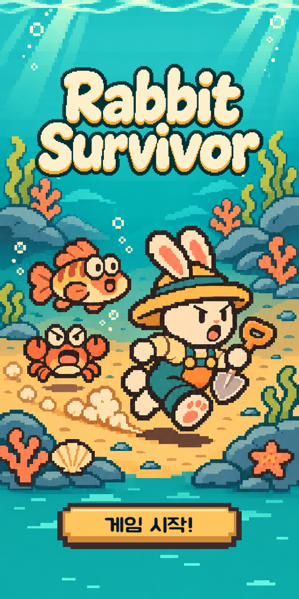
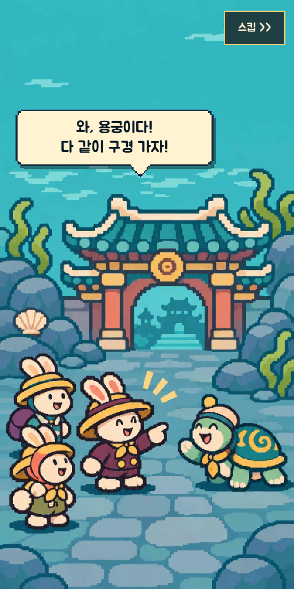
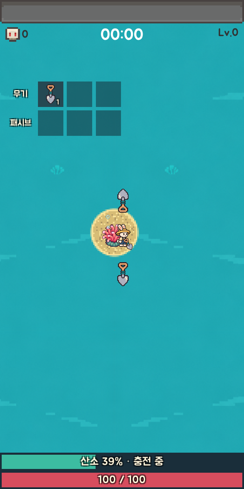
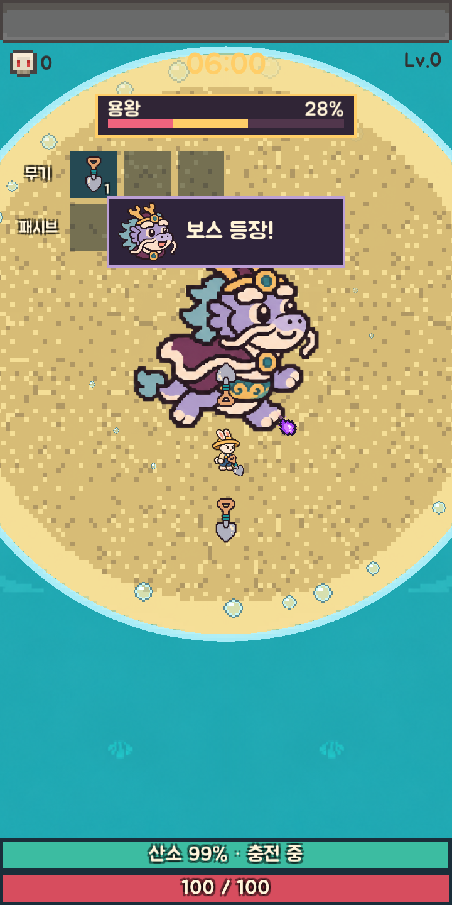
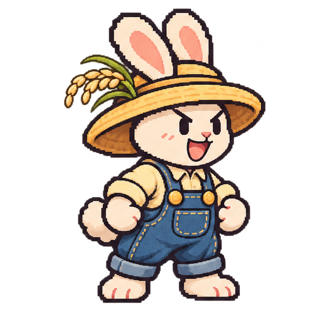
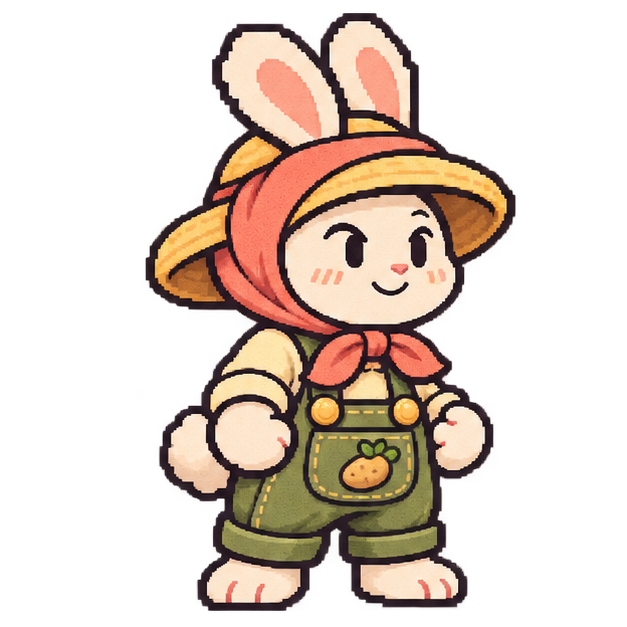

  

<h1 align="center">레빗서바이벌 · Rabbit Survivor</h1>

  <strong>산소를 채우고 씨앗으로 길을 열어, 별주부전의 용궁에서 살아남는 모바일 2D 뱀서라이크</strong>

  <a href="https://github.com/EndDeal/RabbitSurvivor/releases/download/v1.0.11/RabbitSurvivor-v1.0.11.apk"><strong>Android APK 다운로드</strong></a>
  &nbsp;·&nbsp;
  <a href="https://github.com/EndDeal/RabbitSurvivor/releases/tag/v1.0.11">v1.0.11 변경 내역</a>
  &nbsp;·&nbsp;
  <a href="https://github.com/EndDeal/RabbitSurvivor/tree/8a8c3f7e4e97cd47ca95f7d061c80b9024fd756d">Unity 소스</a>
  &nbsp;·&nbsp;
  <a href="https://github.com/EndDeal/RabbitSurvivor/blob/8a8c3f7e4e97cd47ca95f7d061c80b9024fd756d/docs/RabbitSurvivor-Data.xlsx">엑셀 데이터테이블</a>

| 시작 화면 | 용궁 오프닝 | 말미잘 산소 보급 | 용왕전 |
| :---: | :---: | :---: | :---: |
|  |  |  |  |

## 한 판의 재미

- **산소를 채울 때를 고릅니다.** 토끼를 움직여 적을 피하면 무기가 자동으로 공격합니다. 산소가 부족할 때 적이 보급처를 막고 있으면 바로 돌파할지, 돌아갈지, 씨앗을 발동할 1초를 쓸지 판단합니다.
- **키울 무기와 짝 패시브를 고릅니다.** 무기마다 진화에 필요한 패시브가 다릅니다. 무기 Lv.5와 짝 패시브를 갖추면 보물상자에서 진화할 수 있습니다.
- **게임 시계 3분과 6분에 두 보스를 만납니다.** 대장 거북을 격파해 진화 기회를 얻고, 키운 장비로 용왕을 쓰러뜨리면 승리합니다.

### 씨앗 네 가지

씨앗 위에 1초 동안 머무르면 작물이 발동합니다. 적이 다가오는 동안 어느 자리에 멈출지부터 선택이 시작됩니다.

| 씨앗 | 전투에서 맡는 역할 |
| --- | --- |
| **쌀떡길** | 마지막 이동 방향으로 길을 내고, 겹친 돌을 부수며 적과 독방울을 막습니다. |
| **밀짚 허수아비** | 적을 유인해 추격을 흩뜨립니다. 그 사이 보석을 줍거나 보급처에 접근합니다. |
| **감자 지뢰** | 적을 덫으로 유인합니다. 쓰러진 일반 적의 자리에서 폭발이 이어집니다. |
| **당근 포탑** | 가까운 적을 쏴 주므로 토끼가 회피하거나 보급하러 갈 때도 공격을 이어갈 수 있습니다. |

## 농부 토끼 네 마리

| 쌀 토끼 | 밀 토끼 | 감자 토끼 | 당근 토끼 |
| :---: | :---: | :---: | :---: |
|  |  |  |  |
| 삽 이동 속도 +10% | 낫 공격 간격 −10% | 괭이 무기 피해 +20% | 엽총 원거리 발사 수 +1 |
| 기본 캐릭터 | 기본 캐릭터 | 한 판에서 적 20마리 처치 | 용왕 격파 |

## Unity와 AI로 만든 과정

| 단계 | 실제로 한 일 |
| --- | --- |
| **기획 판단** | 첫 씨앗을 놓치기 쉬운 구간을 플레이로 찾아, 등장 시점을 앞당기고 화면 안에서 접근할 수 있게 배치했습니다. 이후에는 가던 길을 바꿀지 선택하도록 거리를 뒀습니다. |
| **AI 활용** | 씨앗 배치와 진화 보상 분기 구현, 문제 재현 조건 정리, Unity 원본과 엑셀 수치 대조에 활용했습니다. |
| **Unity 확인** | 세로 Play Mode에서 첫 씨앗 안내·발동, 산소 경고·충전·고갈, 보스 체력 %와 독방울 잔상을 재현해 확인했습니다. |

v1.0.11에서는 망둥어와 용왕의 독방울을 약 9% 느리게 하고, 스프라이트를 키우고 밝은 잔상을 추가했습니다. 두 보스의 체력은 남은 비율을 정수 %로 표시합니다. [v1.0.11 릴리스 노트](https://github.com/EndDeal/RabbitSurvivor/releases/tag/v1.0.11)

## Unity에서 실행

1. [v1.0.11 소스](https://github.com/EndDeal/RabbitSurvivor/tree/8a8c3f7e4e97cd47ca95f7d061c80b9024fd756d)를 내려받아 Unity **2022.3.57f1**에서 엽니다.
2. `Assets/RabbitSurvivor/Scenes/Title.unity`를 열고 Play를 누릅니다.
3. Android에서는 **가상 스틱**, 에디터에서는 **WASD** 또는 **방향키**로 이동합니다.

[상세 실행 방법과 무기별 진화 조합](https://github.com/EndDeal/RabbitSurvivor/blob/8a8c3f7e4e97cd47ca95f7d061c80b9024fd756d/README.md) · [개발 PR #1](https://github.com/EndDeal/RabbitSurvivor/pull/1)

초기 프로토타입 실행 · main

이 저장소의 `main`에는 초기 Unity 프로젝트가 있습니다. Unity 2022.3.57f1에서 `Assets/RabbitSurvivor/Scenes/RabbitSurvivor.unity`를 열고 Play를 누르면 캐릭터를 선택할 수 있습니다. 에디터에서 WASD 또는 방향키로 이동합니다.

외부 자산

일부 UI·타일 스프라이트, 기본 애니메이션과 오디오는 [Goldmetal 강좌 자산](https://www.goldmetal.co.kr)을 사용했습니다. UI 폰트는 [배민 주아체](https://github.com/google/fonts/tree/main/ofl/jua)입니다.

