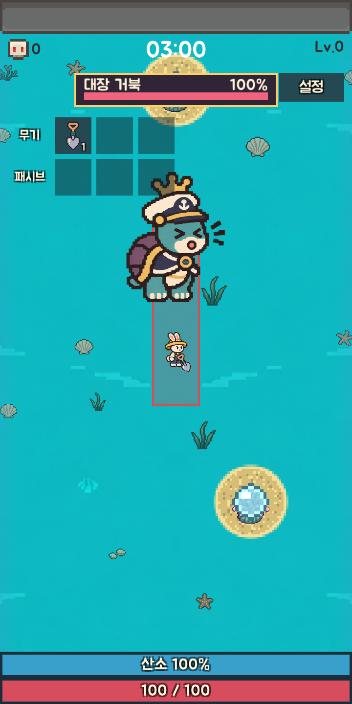
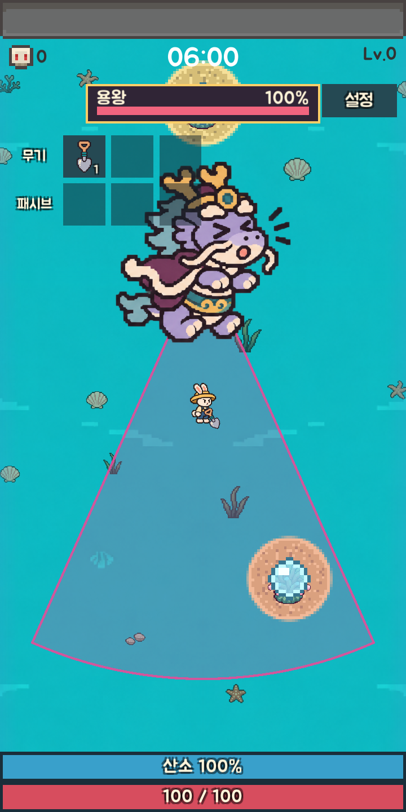

  

<h1 align="center">레빗서바이벌 · Rabbit Survivor</h1>

  <strong>산소를 채우고 씨앗으로 길을 열어, 별주부전의 용궁에서 살아남는 모바일 2D 뱀서라이크</strong>

  <a href="https://github.com/EndDeal/RabbitSurvivor/releases/download/v1.0.15/RabbitSurvivor-v1.0.15.apk"><strong>Android APK 다운로드</strong></a>
  &nbsp;·&nbsp;
  <a href="https://github.com/EndDeal/RabbitSurvivor/releases/tag/v1.0.15">v1.0.15 변경 내역</a>
  &nbsp;·&nbsp;
  <a href="https://github.com/EndDeal/RabbitSurvivor/tree/v1.0.15">Unity 소스</a>
  &nbsp;·&nbsp;
  <a href="https://github.com/EndDeal/RabbitSurvivor/blob/v1.0.15/docs/RabbitSurvivor-Data.xlsx">엑셀 데이터테이블</a>

| 시작 화면 | 용궁 오프닝 | 말미잘 산소 보급 | 용왕전 |
| :---: | :---: | :---: | :---: |
|  |  |  |  |

## 한 판의 재미

- **산소를 채울 때를 고릅니다.** 토끼를 움직여 적을 피합니다. 무기는 자동으로 공격합니다. 산소가 부족할 때 적이 보급처를 막고 있으면 바로 돌파할지, 돌아갈지, 씨앗을 발동할 1초를 쓸지 판단합니다.
- **키울 무기와 짝 패시브를 고릅니다.** 무기마다 진화에 필요한 패시브가 다릅니다. 무기 Lv.5와 짝 패시브를 갖추면 보물상자에서 진화할 수 있습니다.
- **게임 시계 3분과 6분에 두 보스를 만납니다.** 대장 거북을 격파해 진화 기회를 얻고, 키운 장비로 용왕을 쓰러뜨리면 승리합니다.

## 실행과 조작

Android 테스트 빌드는 [v1.0.15 릴리스](https://github.com/EndDeal/RabbitSurvivor/releases/tag/v1.0.15)에서 받을 수 있습니다. [APK 다운로드](https://github.com/EndDeal/RabbitSurvivor/releases/download/v1.0.15/RabbitSurvivor-v1.0.15.apk)

1. Unity Hub에서 저장소 폴더를 Unity **2022.3.57f1**로 엽니다.
2. `Assets/RabbitSurvivor/Scenes/Title.unity`를 열고 Play를 누릅니다.
3. 로딩이 끝나면 **게임 시작!**을 누르고 캐릭터와 얕은 바다 스테이지를 선택합니다. 용궁 이야기는 화면 왼쪽 위 **스킵** 버튼으로 건너뛸 수 있습니다.
4. 키보드에서는 **WASD** 또는 **방향키**, 터치 화면에서는 **가상 스틱**으로 이동합니다. 무기는 자동으로 공격합니다. 캐릭터 선택 화면에서 뒤로가기를 누르면 종료 여부를 확인합니다. HUD의 설정 메뉴에서 볼륨, 계속하기, 다시 시작, 종료를 선택할 수 있습니다.

`File > Build Settings`에는 `Title`과 `RabbitSurvivor`가 순서대로 등록되어 있습니다.

## 한 판의 흐름

- 처치한 적이 떨어뜨리는 경험치 보석을 주워 레벨을 올립니다. 보석은 XP에 따라 여섯 가지 색으로 구분되며 기본 1.65유닛 안에서 끌려옵니다. 자석은 멀리 있는 보석도 모으고, 회복약은 체력을 회복합니다.
- 물속에서 산소가 줄어듭니다. 말미잘이 공기방울을 뿜는 지름 약 2유닛의 노란 모래 구역에 들어가면 산소가 서서히 찹니다. 산소가 떨어지면 체력이 줄어듭니다. 용왕전에서는 노란 모래로 표시된 경기장 전체에서 숨을 쉴 수 있습니다.
- 화면 가장자리와 산소 HUD는 정상일 때 파랑, 잔량 경고 시 금색, 보급 중 초록, 고갈 시 빨강으로 표시합니다. 적에게 맞으면 가장자리가 붉게 깜빡입니다.
- 청록색 바다 바닥에 작은 불가사리·조개·해초 6종을 배치했습니다. 장식은 통과할 수 있고, 산소 보급처 주변은 비워 두었습니다. 화면 밖 장식은 재사용해 이동 중 오브젝트 수를 관리합니다.
- 장벽을 만드는 투구게와 보라색 독방울을 쏘는 망둥어가 등장합니다. 해저 돌에 이동이 막힐 수 있고, 투구게는 장벽과 겹치는 돌을 부숩니다.
- **3:00**에 해저 돌과 투구게를 부수며 돌진하는 대장 거북, **6:00**에 독방울을 연사하고 호위 거북을 부르는 용왕이 나타납니다. 보스 체력은 남은 비율을 정수 %로 표시합니다. 보스전 동안 게임 시계와 일반 웨이브의 새 적 생성이 멈춥니다. 용왕을 쓰러뜨리면 승리합니다.
- 일반 웨이브는 1분 30초 단위로 바뀌며 기본 적 체력은 순서대로 13, 21, 35, 48 HP입니다. 투구게는 48 HP, 망둥어는 14 HP입니다. 대장 거북은 188 HP, 용왕은 720 HP입니다.
- 대장 거북의 보물상자는 진화 조건을 갖춘 무기에 사용할 수 있습니다. 조건을 아직 갖추지 못했다면 보유 장비 중 강화 가능한 하나가 한 단계 오르고, 이후 진화에 사용할 장비 강화권을 받습니다.
- 결과 화면은 체력이 0이면 `DEAD`, 용왕을 처치하면 `SURVIVED!`를 표시합니다. 두 제목에는 크림색 글자와 짙은 외곽선을 적용했습니다. **돌아가기**를 누르면 캐릭터 선택으로 복귀합니다.

v1.0.15에서는 잡몹 체력을 약 13% 낮추고 보스 체력을 약 1.5배 늘렸습니다. 적 수·등장 간격·경험치와 공격 수치는 유지해, 일반 구간을 돌파하기 쉽게 하고 보스와 공방할 시간을 확보했습니다.

## 보스 공격 전조

공격이 시작되기 전에 위험한 방향과 위치를 표시합니다. 전조는 발동 시 사라지며, 일시정지하면 대기 시간도 함께 멈춥니다.

| 보스 행동 | 전조 | 확인할 판단 |
| --- | --- | --- |
| 대장 거북 돌진 | 0.65초 전 빨간 사각형. 실제 충돌체 폭과 돌진 구간을 포함하며 조준 방향은 고정 | 사각형 옆으로 벗어나 돌진을 피하기 |
| 용왕 독방울 연사 | 0.55초 전 분홍 부채꼴. 7발이 퍼지는 전체 48도 방향을 표시 | 부채꼴 밖으로 빠질 방향 고르기 |
| 용왕 호위 거북 소환 | 0.8초 전 주황 원. 용왕 외형 밖에 나타나며 표시한 위치에 생성 | 소환 위치를 보고 다음 이동 경로 고르기 |

  

Unity 세로 Play Mode에서 전조 후 공격, 표시 위치와 실제 생성 위치, 일시정지, 보스 비활성화 시 전조 제거를 확인했습니다. 호위 거북은 한 번에 최대 3마리, 동시에 최대 6마리이며 소환 완료 후 9초를 기다립니다.

## 씨앗과 감자 연쇄

- 첫 씨앗은 약 14초에 토끼로부터 2.5–3.8유닛 떨어진 화면 안에 등장합니다. 이후에는 약 24초 간격으로 기존 씨앗에서 떨어진 곳에 나타납니다. 첫 씨앗부터 작물 4종과 등급을 무작위로 뽑습니다. 화면 밖 씨앗은 화면 가장자리의 작물 말풍선으로 안내합니다. 씨앗 위에 1초 동안 머무르면 발동합니다.
- 쌀은 마지막 이동 방향으로 토끼가 밟고 건널 수 있는 쌀떡길을 만듭니다. 등급에 따라 최대 길이는 2.75–7.15유닛, 폭은 1.15–1.63유닛, 유지 시간은 8–16초, 적 접촉 피해는 3–11입니다. 길은 겹치는 해저 돌을 부수고 적과 독방울을 막습니다.
- 밀은 적을 유인하는 허수아비를 세우고, 당근은 가까운 적을 쏘는 포탑이 됩니다. 에픽부터 허수아비의 유인 파동, 지뢰의 겹친 폭발 고리, 포탑의 발사 효과를 볼 수 있습니다.
- 감자를 활성화하면 그 자리에 지뢰를 설치합니다. 적이 지뢰를 밟으면 1초 뒤에 폭발하며, 쓰러진 일반 적의 자리에서 다음 폭발이 이어집니다. 3마리부터 전투 HUD에 연쇄 처치 수가 표시됩니다.
- 타이틀·선택·스토리와 보스전에 자체 제작한 임시 배경 음악을 사용합니다. 보석을 연달아 주우면 효과음의 음이 올라갑니다.

## 농부 토끼 네 마리

| 쌀 토끼 | 밀 토끼 | 감자 토끼 | 당근 토끼 |
| :---: | :---: | :---: | :---: |
|  |  |  |  |
| 삽 이동 속도 +10% | 낫 공격 간격 −10% | 괭이 무기 피해 +20% | 엽총 발사체 +1 (삽 회전체·엽총 탄환, 진화형 포함) |
| 기본 캐릭터 | 기본 캐릭터 | 한 판에서 적 20마리 처치 | 용왕 격파 |

## 장비와 진화

한 판에 무기와 패시브를 각각 **3개**까지 장착할 수 있습니다. 장비는 **Lv.5**까지 강화할 수 있고, 해당 무기가 Lv.5이고 조합에 필요한 패시브를 보유하면 **한 판에 1회** 진화할 수 있습니다. 고를 장비가 없을 때 나오는 **새참**은 체력을 최대치까지 회복합니다.

첫 진화 전에는 레벨업 보상에 강화 가능한 시작 무기와 장착할 수 있는 진화용 패시브가 나옵니다. 시작 무기 강화 4번과 짝 패시브를 우선 고르면 첫 5번의 레벨업(누적 50 XP)으로 진화 조건을 채울 수 있습니다.

초반 무기 밸런스 기준으로 엽총의 기본 피해는 5, 낫의 기본 공격 반경은 2.25유닛, 괭이의 기본 공격 간격은 1.85초입니다.

| 무기 | 공격 방식 | 필요 패시브 | 진화 |
| --- | --- | --- | --- |
| 삽 | 몸 주위를 돌며 닿는 적을 공격. 진화하면 회전 삽이 두 개 늘어난다. 2.4초 주기로 궤도 반경, 삽 크기와 타격 판정이 함께 변하고 손에 든 삽의 외형도 바뀐다 | 농장 장화 | 풍년 삽 |
| 엽총 | 멀리 발사하고 강화할수록 일렬로 선 적을 더 많이 관통 | 작업 장갑 | 폭풍 엽총 |
| 낫 | 마지막 이동 방향 앞을 넓게 베기 | 숫돌 | 황금 낫 |
| 괭이 | 사거리 안에서 적이 가장 많이 모인 곳을 찍기 | 물뿌리개 | 대지 괭이 |
| 호미 | 사거리 안에서 보스와 최대 체력이 높은 적을 우선 찌르기 | 손목 보호대 | 송곳 호미 |
| 가래 | 좁고 긴 직선의 적을 밀어내기 | 수확 상자 | 황소 가래 |
| 도리깨 | 몸 주위의 적을 한꺼번에 타격하고 원형 파동으로 범위를 표시 | 씨앗 자루 | 풍년 도리깨 |

## 데이터 테이블

[게임 데이터 테이블 다운로드](docs/RabbitSurvivor-Data.xlsx)

캐릭터, 무기, 패시브, 진화, 씨앗, 적과 웨이브, 보스, 경험치, 산소·HUD, 전투·연출 값을 20개 시트로 정리했습니다. 각 표 아래에서 컬럼별 자료형을 선택한 이유를 읽고 Unity 원본을 찾을 수 있습니다. 게임에 적용할 수치는 Unity 원본에서 수정합니다.

적마다 획득 XP는 고정이며, 그 값이 속한 보석 외형 적용 XP 구간에 따라 보석의 색상과 크기가 정해집니다.

장비 ID는 정수입니다. 무기는 `01–09`, 패시브는 `11–19`, 회복 항목인 새참은 `00`을 사용합니다. 씨앗은 쌀 `20`, 밀 `21`, 감자 `22`, 당근 `23`으로 구분하며 등급은 별도 코드 `0–4`로 기록합니다.

## 프로젝트 구조

| 경로 | 내용 |
| --- | --- |
| `Assets/RabbitSurvivor/Scenes` | 타이틀, 캐릭터 선택 이후 진행, 메인 전투 씬 |
| `Assets/RabbitSurvivor/Art` | 토끼, 적, 농기구, 해저, 타이틀과 오프닝 아트 |
| `Assets/RabbitSurvivor/Data` | 무기, 패시브, 회복, 진화 조합 데이터 |
| `Assets/RabbitSurvivor/Prefabs` | 적과 투사체 프리팹 |
| `Assets/RabbitSurvivor/Animations` | 플레이어와 적의 기본 애니메이션 컨트롤러 |
| `Assets/RabbitSurvivor/Audio` · `Fonts` | 배경 음악, 효과음, UI 폰트 |
| `Assets/RabbitSurvivor/Settings` | 입력 액션과 렌더러 설정 |
| `Assets/RabbitSurvivor/Scripts` | 이동, 전투, 적 행동, 성장, UI |
| `docs` | Excel 밸런스 데이터 |

## 외부 자산 출처

- 일부 UI·타일 스프라이트, 기본 애니메이션, 오디오에 Goldmetal의 강좌 자산을 사용합니다. [Goldmetal](https://www.goldmetal.co.kr)
- UI 폰트는 배민 주아체입니다. [Jua · Google Fonts](https://github.com/google/fonts/tree/main/ofl/jua) · [OFL 라이선스](Assets/RabbitSurvivor/Fonts/Jua-OFL.txt)
