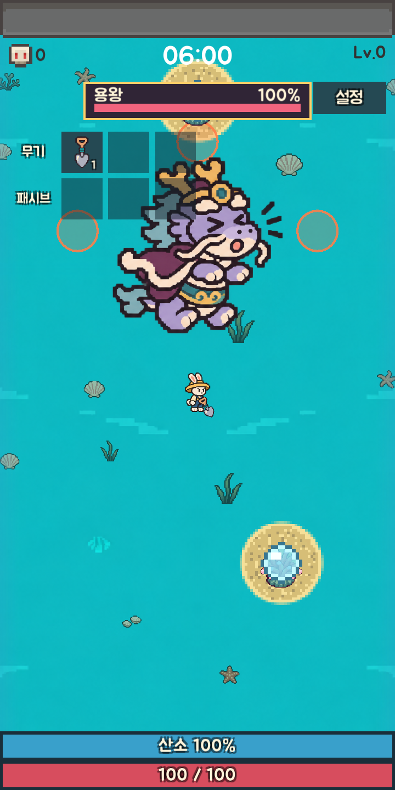

  

<h1 align="center">레빗서바이벌 · Rabbit Survivor</h1>

  별주부전의 용궁을 배경으로 만든 2D 생존 게임

  <a href="https://github.com/EndDeal/RabbitSurvivor/releases/download/v1.0.16/RabbitSurvivor-v1.0.16.apk"><strong>Android APK 다운로드</strong></a>
  &nbsp;·&nbsp;
  <a href="https://github.com/EndDeal/RabbitSurvivor/releases/tag/v1.0.16">v1.0.16 변경 내역</a>
  &nbsp;·&nbsp;
  <a href="https://github.com/EndDeal/RabbitSurvivor/tree/v1.0.16">Unity 소스</a>
  &nbsp;·&nbsp;
  <a href="https://github.com/EndDeal/RabbitSurvivor/blob/v1.0.16/docs/RabbitSurvivor-Data.xlsx">엑셀 데이터테이블</a>

| 시작 화면 | 용궁 오프닝 | 말미잘 산소 보급 | 용왕전 |
| :---: | :---: | :---: | :---: |
|  |  |  |  |

## 어떤 게임인가요?

조작법이 복잡하지 않고, 잠깐 시간이 날 때 한 판씩 할 수 있는 게임을 만들고 싶었습니다. 조작은 이동이 전부이고, 공격은 자동입니다. 적을 피하며 경험치 보석을 줍고, 레벨이 오를 때 키울 장비를 고릅니다.

물속에서는 산소가 줄어듭니다. 말미잘 주변의 노란 모래에 들어가면 산소가 차고, 산소가 바닥나면 체력이 깎입니다. 보급처에 적이 몰려 있다면 바로 들어갈 수도 있고, 밀짚 허수아비로 적을 옆으로 유인한 다음 들어갈 수도 있습니다. 씨앗을 발동하려면 그 자리에 1초 동안 머물러야 해서, 적과 거리를 벌려 두는 게 좋습니다.

게임 안 시계가 **3:00**이 되면 대장 거북이 나오고, **6:00**에는 용왕이 나옵니다. 보스전 중에는 시계가 멈춥니다. 대장 거북의 상자로 무기를 진화시키고, 용왕을 쓰러뜨리면 승리합니다.

## 실행하기

Android에서는 위의 APK를 설치해 플레이할 수 있습니다. 화면의 가상 스틱으로 토끼를 움직입니다.

Unity에서 실행하려면 프로젝트를 **2022.3.57f1**로 열고 `Assets/RabbitSurvivor/Scenes/Title.unity`에서 Play를 누릅니다. **게임 시작!**을 누른 뒤 토끼와 **얕은 바다**를 선택하세요. 키보드에서는 **WASD**나 **방향키**로 움직입니다. 오프닝은 화면 왼쪽 위 **스킵**으로 넘길 수 있습니다.

## 씨앗 네 가지

| 씨앗 | 쓰는 법 |
| --- | --- |
| 쌀떡길 | 마지막으로 움직인 방향으로 길을 냅니다. 토끼는 길을 밟고 지나갈 수 있고, 적과 독방울은 막힙니다. |
| 밀짚 허수아비 | 일반 적을 유인합니다. 그사이 보석을 줍거나 산소를 채우러 갈 수 있습니다. |
| 감자 지뢰 | 적이 밟으면 1초 뒤에 폭발합니다. 폭발로 쓰러진 일반 적 자리에서도 폭발이 이어져, 적을 모아 두면 여러 마리를 한꺼번에 잡을 수 있습니다. |
| 당근 포탑 | 가까운 적을 대신 쏩니다. 적을 피해 움직이는 동안에도 공격을 이어갈 수 있습니다. |

씨앗 생성과 쌀떡길 수치

첫 씨앗은 약 14초에 토끼에게서 2.5–3.8유닛 떨어진 화면 안에 나옵니다. 이후에는 약 24초 간격으로 생성됩니다. 종류와 등급은 무작위이며, 화면 밖 씨앗의 위치는 화면 가장자리에 표시합니다.

쌀떡길의 최대 길이는 2.75–7.15유닛, 폭은 1.15–1.63유닛입니다. 8–16초 동안 유지되며, 적이 닿으면 등급에 따라 3–11의 피해를 줍니다. 겹치는 해저 돌도 부술 수 있습니다. 감자 지뢰로 3마리 이상 연쇄 처치하면 HUD에 처치 수가 표시됩니다.

## 농부 토끼 네 마리

| 쌀 토끼 | 밀 토끼 | 감자 토끼 | 당근 토끼 |
| :---: | :---: | :---: | :---: |
|  |  |  |  |
| 삽 이동 속도 +10% | 낫 공격 간격 −10% | 괭이 무기 피해 +20% | 엽총 발사체 +1 (삽 회전체·엽총 탄환, 진화형 포함) |
| 기본 캐릭터 | 기본 캐릭터 | 한 판에서 적 20마리 처치 | 용왕 격파 |

## 장비와 진화

무기와 패시브는 각각 3개까지 들 수 있습니다. 무기를 Lv.5까지 올리고 짝이 되는 패시브를 갖고 있으면 대장 거북이 떨어뜨린 상자로 한 판에 한 번 진화할 수 있습니다. 상자를 열 때 조건을 못 맞췄다면 강화권을 받아 두었다가, 조건을 갖춘 뒤 사용하면 됩니다.

| 무기 | 공격 방식 | 필요 패시브 | 진화 |
| --- | --- | --- | --- |
| 삽 | 몸 주위를 돌며 닿는 적을 공격합니다. 진화하면 회전 삽이 두 개 늘고, 2.4초 주기로 궤도와 삽 크기, 타격 범위가 함께 변합니다. 손에 든 삽의 모습도 바뀝니다. | 농장 장화 | 풍년 삽 |
| 엽총 | 멀리 발사하고 강화할수록 일렬로 선 적을 더 많이 관통 | 작업 장갑 | 폭풍 엽총 |
| 낫 | 마지막 이동 방향 앞을 넓게 베기 | 숫돌 | 황금 낫 |
| 괭이 | 사거리 안에서 적이 가장 많이 모인 곳을 찍기 | 물뿌리개 | 대지 괭이 |
| 호미 | 사거리 안에서 보스와 최대 체력이 높은 적을 우선 찌르기 | 손목 보호대 | 송곳 호미 |
| 가래 | 좁고 긴 직선의 적을 밀어내기 | 수확 상자 | 황소 가래 |
| 도리깨 | 몸 주위의 적을 한꺼번에 타격하고 원형 파동으로 범위를 표시 | 씨앗 자루 | 풍년 도리깨 |

## 보스의 공격 신호

대장 거북 앞에 빨간 사각형이 뜨면 옆으로 피하세요. 용왕은 독방울을 쏘기 전에 분홍색 부채꼴로 방향을 보여 주고, 호위 거북이 나타날 자리에는 주황색 원을 띄웁니다.

  

보스와 웨이브 수치

일반 웨이브는 게임 시계 기준 1분 30초마다 바뀝니다. 기본 잡몹의 체력은 13, 21, 35, 48 HP 순서이며, 투구게는 48 HP, 망둥어는 14 HP입니다. 대장 거북은 188 HP, 용왕은 720 HP입니다. 일반 구간에서 잡몹이 오래 쌓이는 부담을 줄이고, 보스전에서는 패턴을 더 볼 수 있도록 체력을 조정했습니다.

돌진 예고는 0.65초, 독방울 연사 예고는 0.55초, 호위 거북 소환 예고는 0.8초입니다. 용왕은 독방울 7발을 부채꼴 방향으로 쏩니다. 호위 거북은 한 번에 최대 3마리, 동시에 최대 6마리까지 나옵니다.

## 데이터와 맵 추가

[엑셀 데이터테이블](docs/RabbitSurvivor-Data.xlsx)에 장비 조합, 씨앗, 적, 산소 관련 수치 등을 21개 시트로 정리했습니다. 시트마다 자료형을 정한 이유와 Unity에서 값을 찾을 위치를 적었습니다. 적이 주는 XP는 고정이며, 그 값에 해당하는 구간으로 보석의 색과 크기를 정합니다.

지금은 **얕은 바다**에서 플레이할 수 있습니다. 다음 맵을 추가할 때 선택 화면의 순서가 바뀌어도 같은 맵을 가리키도록, `StageCatalog`와 엑셀에 맵 ID를 미리 부여했습니다.

| 스테이지 ID | 맵 | 현재 상태 | 실행 씬 |
| --- | --- | --- | --- |
| 1001 | 얕은 바다 | 입장 가능 | RabbitSurvivor |
| 1002 | 바닷가 | 추가 예정 · 잠김 | 미연결 |
| 1003 | 농장 | 추가 예정 · 잠김 | 미연결 |
| 1004 | 심해 | 추가 예정 · 잠김 | 미연결 |

Unity 폴더와 사용한 외부 자산

| 경로 | 내용 |
| --- | --- |
| `Assets/RabbitSurvivor/Scenes` | 타이틀, 캐릭터 선택 이후 진행, 메인 전투 씬 |
| `Assets/RabbitSurvivor/Art` | 토끼, 적, 농기구, 해저, 타이틀과 오프닝 아트 |
| `Assets/RabbitSurvivor/Data` | 무기, 패시브, 회복, 진화 조합 데이터 |
| `Assets/RabbitSurvivor/Prefabs` | 적과 투사체 프리팹 |
| `Assets/RabbitSurvivor/Animations` | 플레이어와 적의 기본 애니메이션 컨트롤러 |
| `Assets/RabbitSurvivor/Audio` · `Fonts` | 배경 음악, 효과음, UI 폰트 |
| `Assets/RabbitSurvivor/Settings` | 입력 액션과 렌더러 설정 |
| `Assets/RabbitSurvivor/Scripts` | 이동, 전투, 적 행동, 성장, UI |
| `docs` | Excel 밸런스 데이터 |

**외부 자산 출처**

- 일부 UI·타일 스프라이트, 기본 애니메이션, 오디오에 Goldmetal의 강좌 자산을 사용합니다. [Goldmetal](https://www.goldmetal.co.kr)
- UI 폰트는 배민 주아체입니다. [Jua · Google Fonts](https://github.com/google/fonts/tree/main/ofl/jua) · [OFL 라이선스](Assets/RabbitSurvivor/Fonts/Jua-OFL.txt)

