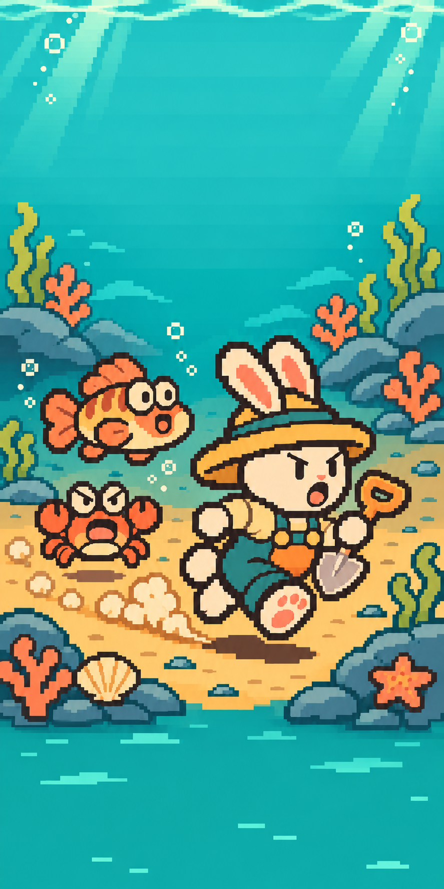

# 레빗서바이벌 · Rabbit Survivor

농부 토끼가 씨앗을 발동하고 농기구를 진화시켜 용궁을 탈출하는 Unity 2D 픽셀 아트 뱀서라이크입니다. 이동만으로 싸우고, 네 토끼의 시작 무기와 해저에 나타나는 씨앗으로 매 판 다른 빌드를 만듭니다.

게임 시계 3분에 대장 거북, 6분에 용왕이 등장합니다. 개발 빌드의 변경 사항과 QA 결과는 [개발 PR #1](https://github.com/EndDeal/RabbitSurvivor/pull/1)에 정리했습니다.

- 씨앗 위에 1초 머무르면 쌀떡길, 밀짚 허수아비, 감자 지뢰, 당근 포탑이 발동합니다.
- 농기구는 7종이며, 장비를 강화하고 패시브를 조합해 진화시킵니다.
- 감자 지뢰로 몰려드는 적을 연쇄 폭발에 휘말리게 하고, 용왕을 쓰러뜨려 승리합니다.

## 실행과 조작

1. Unity Hub에서 저장소 폴더를 Unity **2022.3.57f1**로 엽니다.
2. `Assets/RabbitSurvivor/Scenes/Title.unity`를 열고 Play를 누릅니다.
3. 로딩이 끝나면 **게임 시작!**을 누르고 캐릭터와 얕은 바다 스테이지를 선택합니다. 용궁 이야기는 화면 왼쪽 위 **스킵** 버튼으로 건너뛸 수 있습니다.
4. 키보드에서는 **WASD** 또는 **방향키**, 터치 화면에서는 **가상 스틱**으로 이동합니다. 무기는 자동으로 공격합니다. 캐릭터 선택 화면에서 뒤로가기를 누르면 종료 여부를 확인합니다. HUD의 설정 메뉴에서 볼륨, 계속하기, 다시 시작, 종료를 선택할 수 있습니다.

`File > Build Settings`에는 `Title`과 `RabbitSurvivor`가 순서대로 등록되어 있습니다.

## 한 판의 흐름

- 처치한 적이 떨어뜨리는 경험치 보석을 주워 레벨을 올립니다. 보석은 XP에 따라 여섯 가지 색으로 구분되며 기본 1.65유닛 안에서 끌려옵니다. 자석은 멀리 있는 보석도 모으고, 회복약은 체력을 회복합니다.
- 장벽을 만드는 투구게와 보라색 독방울을 쏘는 망둥어가 등장합니다. 해저 돌에 이동이 막힐 수 있고, 투구게는 장벽과 겹치는 돌을 부숩니다.
- **3:00**에 해저 돌과 투구게를 부수며 돌진하는 대장 거북, **6:00**에 독방울을 연사하고 호위 거북을 부르는 용왕이 나타납니다. 보스전 동안 게임 시계와 일반 웨이브의 새 적 생성이 멈춥니다. 용왕을 쓰러뜨리면 승리합니다.
- 일반 웨이브는 1분 30초 단위로 바뀌며 기본 적 체력은 순서대로 15, 24, 40, 55 HP입니다. 대장 거북은 125 HP, 용왕은 480 HP입니다.
- 대장 거북의 보물상자는 진화 조건을 갖춘 무기에 사용할 수 있습니다. 조건을 아직 갖추지 못했다면 보유 장비 중 강화 가능한 하나가 한 단계 오르고, 이후 진화에 사용할 장비 강화권을 받습니다.

## 씨앗과 감자 연쇄

- 첫 씨앗은 약 14초에 토끼로부터 2.5~3.8유닛 떨어진 화면 안에 등장합니다. 이후에는 약 24초 간격으로 기존 씨앗에서 떨어진 곳에 나타납니다. 첫 씨앗부터 작물 4종과 등급을 무작위로 뽑습니다. 화면 밖 씨앗은 화면 가장자리의 작물 말풍선으로 안내합니다. 씨앗 위에 1초 동안 머무르면 발동합니다.
- 쌀은 마지막 이동 방향으로 토끼가 밟고 건널 수 있는 쌀떡길을 만듭니다. 등급에 따라 최대 길이는 2.75~7.15유닛, 폭은 1.15~1.63유닛, 유지 시간은 8~16초, 적 접촉 피해는 3~11입니다. 길은 겹치는 해저 돌을 부수고 적과 독방울을 막습니다.
- 밀은 적을 유인하는 허수아비를 세우고, 당근은 가까운 적을 쏘는 포탑이 됩니다. 에픽부터 허수아비의 유인 파동, 지뢰의 겹친 폭발 고리, 포탑의 발사 효과를 볼 수 있습니다.
- 감자를 활성화하면 그 자리에 지뢰를 설치합니다. 적이 지뢰를 밟으면 1초 뒤에 폭발하며, 쓰러진 일반 적의 자리에서 다음 폭발이 이어집니다. 3마리부터 전투 HUD에 연쇄 처치 수가 표시됩니다.
- 타이틀·선택·스토리와 보스전에 자체 제작한 임시 배경 음악을 사용합니다. 보석을 연달아 주우면 효과음의 음이 올라갑니다.

## 캐릭터

| 캐릭터 | 시작 무기 | 특성 | 해금 |
| --- | --- | --- | --- |
| 쌀 토끼 | 삽 | 이동 속도 +10% | 기본 |
| 밀 토끼 | 낫 | 공격 간격 −10% | 기본 |
| 감자 토끼 | 괭이 | 무기 피해 +20% | 한 판에서 적 20마리 처치 |
| 당근 토끼 | 엽총 | 원거리 무기의 수 +1. 엽총은 추가 관통 +1 | 용왕 처치 후 승리 |

## 장비와 진화

한 판에 무기와 패시브를 각각 **3개**까지 장착할 수 있습니다. 장비는 **Lv.5**까지 강화할 수 있고, 해당 무기가 Lv.5이고 조합에 필요한 패시브를 보유하면 **한 판에 1회** 진화할 수 있습니다. 고를 장비가 없을 때 나오는 **새참**은 체력을 최대치까지 회복합니다.

첫 진화 전에는 레벨업 보상에 강화 가능한 시작 무기와 장착할 수 있는 진화용 패시브가 나옵니다. 시작 무기 강화 4번과 짝 패시브를 우선 고르면 첫 5번의 레벨업(누적 50 XP)으로 진화 조건을 채울 수 있습니다.

초반 무기 밸런스 기준으로 엽총의 기본 피해는 5, 낫의 기본 공격 반경은 2.25유닛, 괭이의 기본 공격 간격은 1.85초입니다.

| 무기 | 공격 방식 | 필요 패시브 | 진화 |
| --- | --- | --- | --- |
| 삽 | 몸 주위를 돌며 닿는 적을 공격. 진화하면 삽 두 개를 추가해 여덟 개를 한 원에 배치한다. 2.4초 주기로 궤도 반경, 삽 크기와 타격 판정이 함께 변하고 손에 든 삽의 외형도 바뀐다 | 농장 장화 | 풍년 삽 |
| 엽총 | 멀리 발사하고 강화할수록 일렬로 선 적을 더 많이 관통 | 작업 장갑 | 폭풍 엽총 |
| 낫 | 마지막 이동 방향 앞을 넓게 베기 | 숫돌 | 황금 낫 |
| 괭이 | 사거리 안에서 적이 가장 많이 모인 곳을 찍기 | 물뿌리개 | 대지 괭이 |
| 호미 | 사거리 안에서 보스와 최대 체력이 높은 적을 우선 찌르기 | 손목 보호대 | 송곳 호미 |
| 가래 | 좁고 긴 직선의 적을 밀어내기 | 수확 상자 | 황소 가래 |
| 도리깨 | 몸 주위의 적을 한꺼번에 타격 | 씨앗 자루 | 풍년 도리깨 |

## 데이터 테이블

[게임 데이터 테이블 다운로드](docs/RabbitSurvivor-Data.xlsx)

캐릭터, 무기, 패시브, 진화, 씨앗, 적과 웨이브, 보스, 경험치, 전투·연출 값을 19개 시트로 정리했습니다. 각 표 아래에서 컬럼별 C# 타입을 선택한 이유와 Unity 원본을 확인할 수 있습니다. 게임에 적용할 수치는 Unity 원본에서 수정합니다.

장비 ID는 정수입니다. 무기는 `01–09`, 패시브는 `11–19`, 회복 항목인 새참은 `00`을 사용합니다. 씨앗은 쌀 `20`, 밀 `21`, 감자 `22`, 당근 `23`으로 구분하며 등급은 별도 코드 `0–4`로 기록합니다.

## 프로젝트 구조

| 경로 | 내용 |
| --- | --- |
| `Assets/RabbitSurvivor/Scenes` | 타이틀, 캐릭터 선택 이후 진행, 메인 전투 씬 |
| `Assets/RabbitSurvivor/Art` | 토끼, 적, 농기구, 해저, 타이틀과 오프닝 아트 |
| `Assets/RabbitSurvivor/Data` | 무기, 패시브, 회복, 진화 조합 데이터 |
| `Assets/RabbitSurvivor/Prefabs` | 적과 투사체 프리팹 |
| `Assets/RabbitSurvivor/Animations` | 플레이어와 적의 기본 애니메이션 컨트롤러 |
| `Assets/RabbitSurvivor/Audio` · `Fonts` | 배경 음악, 효과음, UI 폰트 |
| `Assets/RabbitSurvivor/Settings` | 입력 액션과 렌더러 설정 |
| `Assets/RabbitSurvivor/Scripts` | 이동, 전투, 적 행동, 성장, UI |
| `docs` | Excel 밸런스 데이터 |

## 외부 자산 출처

- 일부 UI·타일 스프라이트, 기본 애니메이션, 오디오에 Goldmetal의 강좌 자산을 사용합니다. [Goldmetal](https://www.goldmetal.co.kr)
- UI 폰트는 배민 주아체입니다. [Jua · Google Fonts](https://github.com/google/fonts/tree/main/ofl/jua) · [OFL 라이선스](Assets/RabbitSurvivor/Fonts/Jua-OFL.txt)
